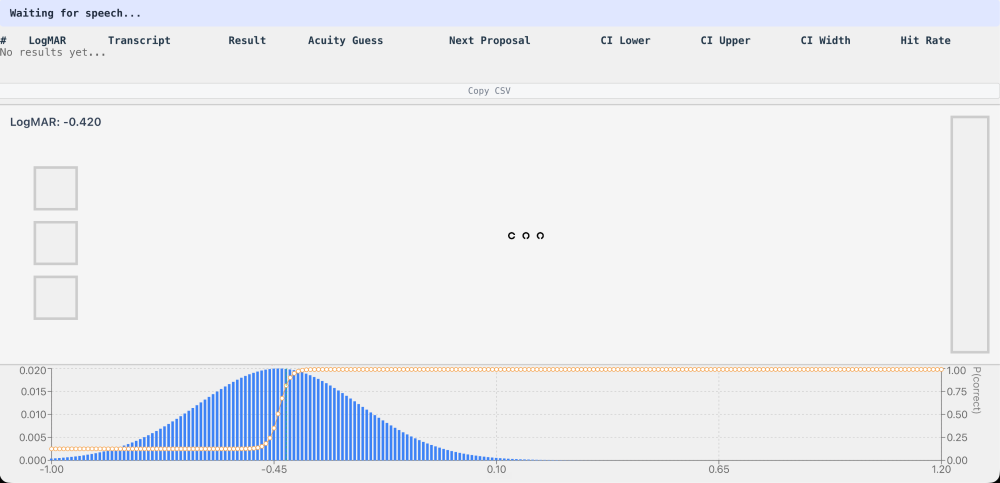
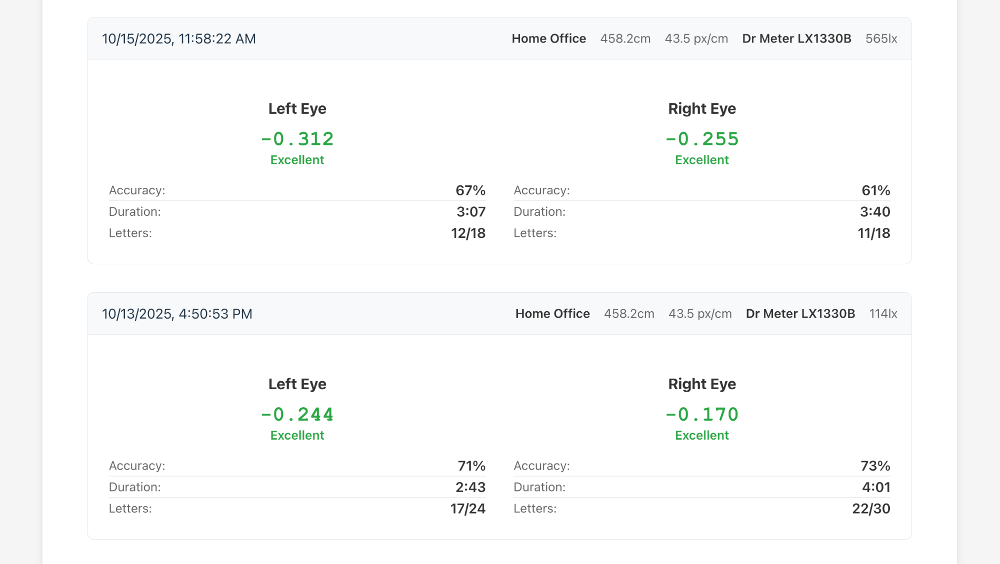

# Man vs Myopia

A web app for measuring your own visual acuity at home, to track myopia over time.



## How it works

- **Adaptive testing.** [QUEST+](https://doi.org/10.1167/17.3.10) (Watson, 2017, *Journal of Vision* 17(3):10) picks each size to most reduce uncertainty in your LogMAR estimate. See `app/src/lib/UserLogMARGuessingEngine.ts`.
- **Spoken answers.** Optotypes are Landolt Cs. You say the compass direction of the opening ("north", "southeast"); Chrome speech recognition scores it.
- **Calibration.** You measure an on-screen reference to set px/cm, set a viewing distance, and can log room lux from a light meter.
- **Storage.** Per-eye results are saved to your account in Firestore.



## Run locally

```
npm install -g firebase-tools
cd app
npm install
firebase emulators:start   # Auth :9099, Firestore :8080
npm run dev                # in a second terminal
```

A personal tool built for one person's n=1 experiment. Not medical advice.
